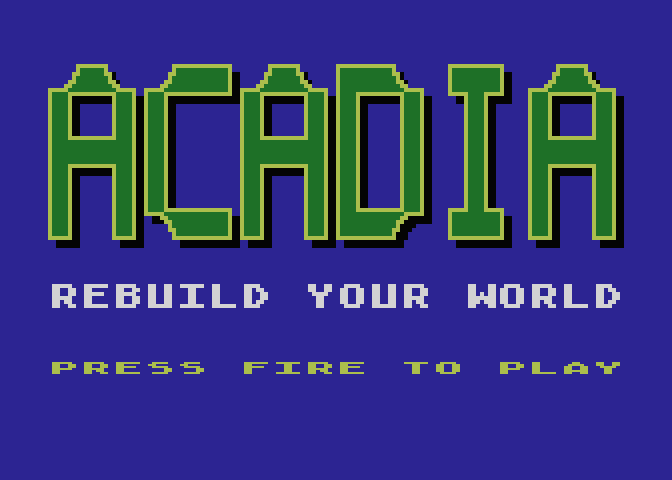
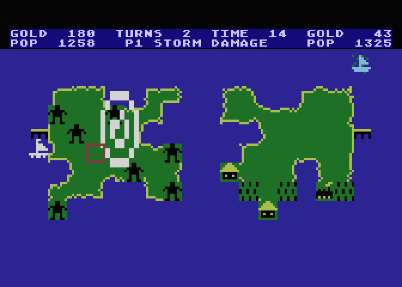

# Acadia

An island-building strategy game for the Atari 8-bit computers (800XL
first), inspired by classics like Mattel's *Utopia* (Intellivision,
1981). Two rulers, two islands, a set number of timed rounds: build
forts, farms, factories, schools and houses, send out fishing boats,
and keep your people fed and happy through storms, pirates and rebels.





## Goals

- Gameplay inspired by Utopia's rules: two islands, buildings bought
  with gold bars, timed rounds, weather, fish, pirates, rebels, and the
  same style of round scoring (see [docs/utopia-rules.md](docs/utopia-rules.md)).
- A single-player mode against a CPU opponent, alongside the
  two-player game.
- POKEY sound effects and music.
- Mixed ANTIC modes: a mode 2 text status bar over a mode 5
  multicolour map, split with display list interrupts.
- Menus and item selection on the keyboard for now; this is a computer.

Acadia is an independent project, not affiliated with or endorsed by
Mattel. All code, graphics, sound and music are new.

## Contributing

Humans and coding agents: start with [AGENTS.md](AGENTS.md). Planning docs:
[SPEC](docs/SPEC.md), [ARCHITECTURE](docs/ARCHITECTURE.md), [PLAN](docs/PLAN.md),
[DECISIONS](docs/DECISIONS.md), [OPEN-QUESTIONS](docs/OPEN-QUESTIONS.md).

## Building

Requires [ATasm](https://github.com/CycoPH/atasm) (MAC/65 compatible) and,
for `make run`, the [atari800](https://atari800.github.io/) emulator.
On macOS: `brew install atasm atari800`. `make test` also needs Python 3
with [py65](https://github.com/mnaberez/py65) (`pip install py65`);
pass `PYTHON=/path/to/python` if it lives in a virtualenv.

```sh
make            # build build/acadia.xex
make run        # build and run in atari800 (800XL, BASIC off)
make test       # build, then run the unit tests (needs py65)
make clean      # remove build/
```

Use a different assembler or emulator binary with
`make ATASM=/path/to/atasm` or `make ATARI800=/path/to/atari800`.

Output is an XEX load file for now; an ATR disk image will follow.

## Source layout

| File | Contents |
|---|---|
| `src/acadia.asm` | Main file, entry point, main loop; includes the rest |
| `src/hw_a800.asm` | GTIA, POKEY, PIA, ANTIC equates and OS shadow registers |
| `src/input.asm` | Input layer: joysticks, triggers, console keys, keyboard |
| `src/math.asm` | 24 × 8 multiply, 24 ÷ 8 divide (truncating and rounded) |
| `src/rand.asm` | `RAND_N`: random number 0..N−1 |
| `src/tic.asm` | 20 Hz game tic and seconds, NTSC and PAL |
| `src/text.asm` | Status bar text and decimal numbers |
| `src/sprites.asm` | Player/missile graphics |
| `src/cursor.asm` | The players' cursors |
| `src/map.asm` | Map grid: items on squares, fort-adjacency check |
| `src/display.asm` | Display lists, DLI, VBI, map drawing (mode 5) |
| `src/economy.asm` | Buying, income, population, score, crops |
| `src/boats.asm` | Steering and parking boats |
| `src/fish.asm`, `src/weather.asm`, `src/pirates.asm`, `src/rebels.asm` | Schools of fish, rain and storms, pirates, rebels |
| `src/ai.asm` | The CPU opponent |
| `src/sound.asm`, `src/music.asm` | POKEY sound effects and music |
| `src/pause.asm`, `src/help.asm` | Pause (P) and the price list (H) |
| `src/screens.asm`, `src/news.asm` | Rounds, summaries, game over, status line |
| `src/setup.asm` | The game setup screen |
| `src/title.asm`, `src/demo.asm` | Title screen and the attract-mode demo |
| `src/vars.asm` | All RAM variables, one block at `$3900` |
| `src/tiles.asm`, `src/font_map.asm`, `src/islands.asm` | Tiles, map fonts, island data (generated by `tools/mkfont.py`) |
| `src/title_gfx.asm` | The title logo (generated by `tools/mktitle.py`) |
| `tools/run6502.py` | Test helper: runs routines from the XEX on a 6502 core |
| `tests/` | Unit tests, run by `make test` |
| `tools/mkfont.py` | Tile art and island outlines; generates the tile, font and island files (`--preview DIR` renders PNG previews of the islands) |
| `tools/mktitle.py` | Draws the title logo |
| `docs/utopia-rules.md` | Rules and constants taken from the original game |

## Assembler compatibility

Source is kept MAC/65 compatible. Deliberate exceptions, which are
ATasm conveniences:

- `.INCLUDE "file.asm"` uses ATasm's quoted filename form. On a real
  MAC/65 setup this becomes `.INCLUDE #D:FILE.M65`.
- Lower-case file names and `.asm` extensions.

No `?local` labels, `.DS`, `.ALIGN` or macros are used; storage is
reserved with `*= *+n`.

## Test targets

1. atari800 emulator (`make run`)
2. MiSTer Atari800 core
3. A real 800XL

## Atari 5200 plan

A 5200 port is a future prospect. To keep it cheap:

- All hardware addresses live in `src/hw_a800.asm`; a 5200 build will
  provide `hw_5200.asm` with the same symbol names (GTIA at `$C000`,
  POKEY at `$E800`, ANTIC at `$D400`, different shadow locations).
- Game code never calls Atari OS ROM routines. It only writes the DLI
  and VBI vectors and the shadow registers, which the 5200 BIOS also
  provides.
- All input goes through `src/input.asm`, which exposes `JOY0/JOY1`,
  `FIRE0/FIRE1` and `KEY`. The 5200 version will map the analog sticks,
  the keypad (items 0-9, a natural fit for the original's keypad
  controls) and the second fire button.
