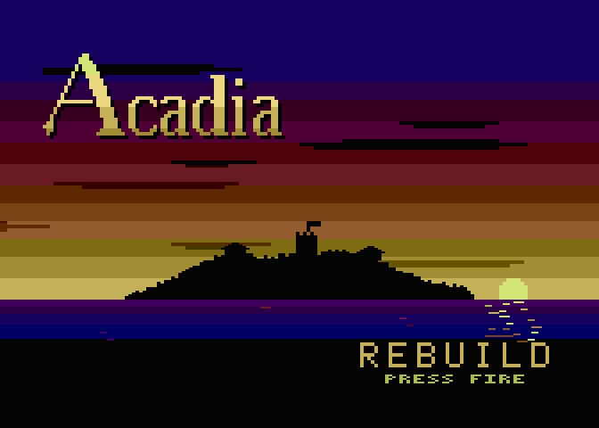
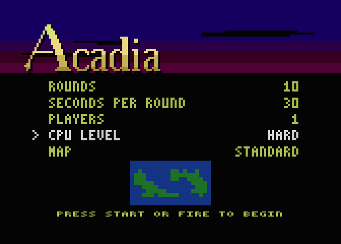
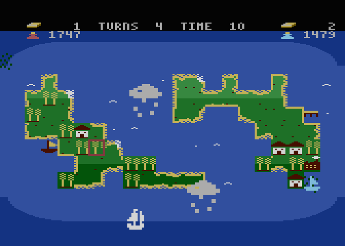
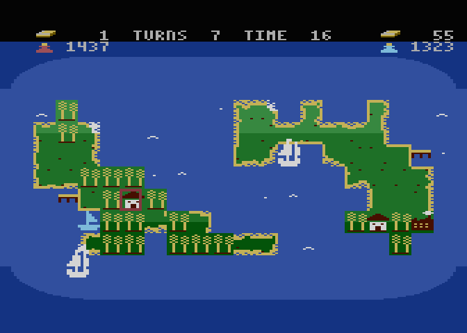
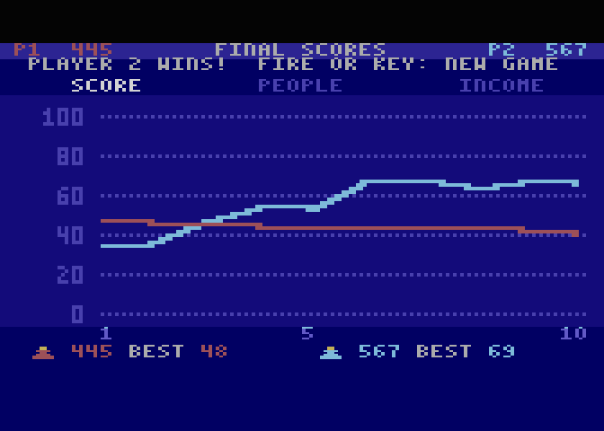
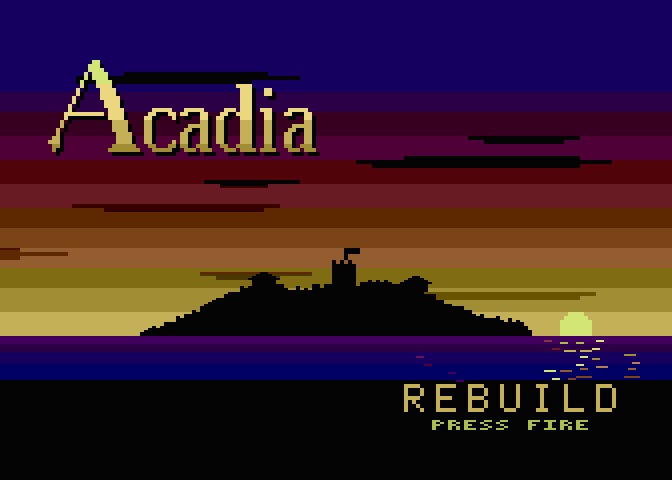

# Acadia

An island-building strategy game for the Atari 8-bit computers and the
Atari 5200, inspired by Mattel's *Utopia* (Intellivision, 1981). Two
rulers, two islands, a set number of timed rounds: build forts, farms,
factories, schools, hospitals and houses, send out fishing boats, and
keep your people fed and happy through storms, pirates and rebels.
Play against a friend or against the computer.



| | |
|---|---|
|  |  |
|  |  |

Acadia is an independent project, not affiliated with or endorsed by
Mattel. All code, graphics, sound and music are new.

## Supported platforms

| Machine | File | Tested on |
|---|---|---|
| Atari 800XL / XE (64K) | `acadia.xex` (`make`) | atari800 emulator, MiSTer Atari800 core, a real 800XL |
| Atari 400 / 800 with 48K | `acadia.xex` | should work, not tested yet |
| Atari 5200 | `acadia5200.car` / `.bin`, a 32K cartridge (`make 5200`) | atari800 `-5200`, MiSTer Atari 5200 core, a real 5200 |

- NTSC is the main target; PAL machines keep the right game speed and
  round clock (20 game tics and one second per second on both).
- The XEX loads with BASIC on or off (on an XL/XE the loader switches
  BASIC off by itself), so it also starts on the MiSTer core, which
  boots with BASIC on.
- An ATR boot disk is planned (T-REL-3).



## Getting started

- **Atari 800/XL/XE:** load `acadia.xex`. In atari800:
  `atari800 -xl -nobasic -run build/acadia.xex` (or `make run`). Plug a
  joystick into port 1, and a second one into port 2 for two players.
- **Atari 5200:** run `acadia5200.car` in an emulator
  (`atari800 -5200 -cart build/acadia5200.car`, or `make run5200`), or
  burn the `.bin` to a 32K cartridge or load it on a flash cart.

The title screen shows a sunset over an island. Press fire (or START,
or any key) to go to the game setup screen. Left alone for 30 seconds,
the title plays a short demo game.

### Game setup

| Line | Choices |
|---|---|
| ROUNDS | 1-50 rounds (the original's "term of office") |
| SECONDS PER ROUND | 30-120, in steps of 5 |
| PLAYERS | 1 (against the computer) or 2 |
| CPU LEVEL | EASY, MEDIUM or HARD (1 player only) |
| MAP | STANDARD (the original's islands) or RANDOM (a new pair every game) |

Stick up/down (or SELECT) picks a line, stick left/right changes it,
and you can also type a number. START or fire begins the game.

## How to play

Player 1 rules the left island (red), player 2 the right island
(turquoise). Each of you starts with **1000 people** and **100 gold
bars**. A game is a number of rounds of a few seconds each; buy and
build during the round, and at the end of every round each island is
paid, its population grows or shrinks, and it gets a **round score**.
The ruler with the higher total score after the last round wins.

### Buying

Move your cursor over a free square of your own island and press a
number key. Without enough gold you hear a refusal buzz. Press `H`
during a round for the price list.

| Key | Item | Gold | What it does |
|---|---|---|---|
| 1 | Fort | 50 | Keeps rebels off the squares around it; protects your fishing boats nearby from pirates and PT boats |
| 2 | Factory | 40 | 4 gold every round, more with schools and hospitals; but people die a little sooner |
| 3 | Crops | 3 | Food for the score and more births; rain over them pays gold. One crop in three is used up at the end of each round |
| 4 | School | 35 | +1 score each round and more factory income; fewer births |
| 5 | Hospital | 75 | +1 score each round, more births, fewer deaths, more factory income |
| 6 | Housing | 60 | Counts towards the housing score; a few more births |
| 7 | Rebels | 30 | Sends rebels to the **other** island, where they wreck what they land on |
| 8 | PT boat | 40 | Stops pirate ships; attacks the other ruler's fishing boats |
| 9 | Fishing boat | 25 | 1 gold a round, plus gold whenever it sits over a school of fish; counts as food |

Boats appear in your harbour, a sea square beside your island; it must
be empty before you can buy the next boat.

### Boats

Press `0`, or tap the fire button, with the cursor on one of your boats
to take the helm: the stick now steers the boat. Press `0` or tap fire
again over open sea to drop anchor there and get your cursor back.
Boats can't cross land.

- A **fishing boat** over a school of fish (the dark green shoals that
  wander across the sea) slowly earns gold, moving or anchored.
- **Pirate galleons** come in from the top or bottom of the map. A
  pirate sinks a moving fishing boat it touches, and slowly sinks an
  anchored one, unless one of your forts is next to it. Your **PT
  boat** stops a pirate dead, and can hunt the other ruler's fishing
  boats the same way.

### The end of a round

Income: 4 gold per factory, 1 per fishing boat, a productivity bonus of
factories × (schools + hospitals) + hospitals (up to 30), and 10 gold
for everyone.

Population: crops, hospitals and houses raise the birth rate, schools
lower it; hospitals lower the death rate, factories raise it.

**Round score** (up to 100), each part measured against your
population, so a growing island needs more of everything:

- **Housing:** houses per person, up to 30.
- **Economy:** gold *earned* this round per person, up to 30.
- **Food:** crops and fishing boats per person, up to 30.
- **Welfare:** +1 for each school and each hospital.

### Rebels and weather

Your people rebel when things get worse: if your round score **fell by
10 or more**, or is **under 30**, a rebel camp (a dark banner with a
gold X) appears on your island, destroying whatever stood there. A
score that **rose by 10 or more**, or is **70 or better**, sends one
away again. Rebels never land on or next to a fort. Nothing can be
built on a rebel square.

Weather drifts across the map: **rain** over your crops pays gold,
**storms** and **hurricanes** damage what they pass over, kill people
and sink anchored boats, and a hurricane sinks any boat or pirate it
touches. Forts don't stop the weather.

### Checking the score

During a round, hold `START` for both total scores, `SELECT` for both
populations and `OPTION` for the last round's scores. After the final
round, fire or a key shows the charts of score, people and income over
the whole game; the stick flips between them, fire or a key goes back
to the setup screen.

## Controls

### Atari 800/XL/XE

| Control | Does |
|---|---|
| Joystick | Moves your cursor, or steers the boat you're at the helm of |
| `1`-`9` | Buy that item at the cursor |
| `0`, or a tap of fire | Take the helm of a boat / anchor it |
| `H` or `HELP` | Price list (the game stands still); again to go back |
| `P` | Pause and unpause |
| `START` / `SELECT` / `OPTION` held | Total scores / populations / last round's scores |
| `RESET` | Back to the title screen (the game in play is lost) |

**Two players** share the keyboard: hold your fire button while you
press a number and it buys for you. With no fire button held, the key
goes to player 1.

**Video Touch Pad:** in a 1-player game, an Atari CX21 Video Touch Pad
or CX50 keypad in port 2 is found by itself when the game starts. Its
`0`-`9` work like the number keys, `*` shows the price list (as on
the 5200) and `#` pauses; the joystick in port 1 still moves the cursor.

### Atari 5200

Each player uses their own controller, so there's no need to hold fire
to buy.

| Control | Does |
|---|---|
| Stick | Moves your cursor, or steers the boat you're at the helm of |
| Keypad `1`-`9` | Buy that item at the cursor |
| Keypad `0` or the top side button | Take the helm of a boat / anchor it |
| Bottom side button | Fire (start the game, go on from screens) |
| `*` | Price list |
| `PAUSE` | Pause and unpause |
| `START` | Begin a game; held during a round, the total scores |
| `#` held | Total scores; press again while holding to step to populations, then the last round |
| `RESET` | Back to the title screen (the game in play is lost) |

In atari800 `-5200`: the numpad is the stick, Right Ctrl the top
button, Shift the bottom button, `0`-`9` the keypad, `=` for `#`,
numpad `*`, `P` pause and F4 START.

### Keypad overlays

Printable overlays for the 5200 controller and the Video Touch Pad,
with the game's icons, are in [docs/overlays](docs/overlays/README.md).

## Building

Requires [ATasm](https://github.com/CycoPH/atasm) (MAC/65 compatible) and,
for `make run`, the [atari800](https://atari800.github.io/) emulator.
On macOS: `brew install atasm atari800`. `make test` also needs Python 3
with [py65](https://github.com/mnaberez/py65) (`pip install py65`);
pass `PYTHON=/path/to/python` if it lives in a virtualenv.

```sh
make            # build build/acadia.xex
make run        # build and run in atari800 (800XL, BASIC off)
make test       # build, then run the unit tests (needs py65)
make 5200       # build the Atari 5200 cartridge: build/acadia5200.car (+ .bin)
make run5200    # build it and run it in atari800 -5200
make clean      # remove build/
```

Use a different assembler or emulator binary with
`make ATASM=/path/to/atasm` or `make ATARI800=/path/to/atari800`.

## Contributing

Humans and coding agents: start with [AGENTS.md](AGENTS.md). Planning docs:
[SPEC](docs/SPEC.md), [ARCHITECTURE](docs/ARCHITECTURE.md), [PLAN](docs/PLAN.md),
[DECISIONS](docs/DECISIONS.md), [OPEN-QUESTIONS](docs/OPEN-QUESTIONS.md).
The original game's rules and numbers are in
[docs/utopia-rules.md](docs/utopia-rules.md).

### Source layout

| File | Contents |
|---|---|
| `src/acadia.asm` | 800 build's main file: entry point, memory layout; includes the rest |
| `src/acadia5200.asm` | Atari 5200 cartridge's main file (D62) |
| `src/main.asm` | Start-up, main loop and zero page, shared by both builds |
| `src/hw_a800.asm`, `src/hw_5200.asm` | GTIA, POKEY, PIA, ANTIC equates and OS / BIOS shadow registers |
| `src/mem_a800.asm`, `src/mem_5200.asm` | Each build's memory map |
| `src/plat_a800.asm`, `src/plat_5200.asm` | Each build's platform hooks (`PLAT_INIT`, `PLAT_MAP`) |
| `src/input.asm` | Input layer: joysticks, triggers, console keys, keyboard |
| `src/input5200.asm` | 5200 input layer: analog sticks, side buttons, keypads (D63) |
| `src/math.asm` | 24 × 8 multiply, 24 ÷ 8 divide (truncating and rounded) |
| `src/rand.asm` | `RAND_N`: random number 0..N−1 |
| `src/tic.asm` | 20 Hz game tic and seconds, NTSC and PAL |
| `src/text.asm` | Status bar text and decimal numbers |
| `src/sprites.asm` | Player/missile graphics |
| `src/cursor.asm` | The players' cursors |
| `src/map.asm` | Map grid: items on squares, fort-adjacency check |
| `src/display.asm` | Display lists, DLI, VBI, map drawing (mode 4) |
| `src/economy.asm` | Buying, income, population, score, crops |
| `src/boats.asm` | Steering and parking boats |
| `src/fish.asm`, `src/weather.asm`, `src/pirates.asm`, `src/rebels.asm` | Schools of fish, rain and storms, pirates, rebels |
| `src/ai.asm` | The CPU opponent |
| `src/sound.asm`, `src/music.asm` | POKEY sound effects and music |
| `src/pause.asm`, `src/help.asm` | Pause (P) and the price list (H) |
| `src/screens.asm`, `src/news.asm` | Rounds, summaries, game over, status line |
| `src/setup.asm` | The game setup screen |
| `src/title.asm`, `src/demo.asm` | Title screen and the attract-mode demo |
| `src/vars.asm` | All RAM variables, one block at `$3900` |
| `src/tiles.asm`, `src/font_map.asm`, `src/isl_live.asm`, `src/isl_live5200.asm`, `src/islands.asm` | Tiles, map fonts, island data (generated by `tools/mkfont.py`) |
| `src/title_gfx.asm`, `src/title_cld.asm` | The title screen's graphics, font, colours and clouds (generated by `tools/mktitle.py`) |
| `src/font_stat.asm` | The status bar font (generated by `tools/mkstat.py`) |
| `tools/run6502.py` | Test helper: runs routines from the XEX on a 6502 core |
| `tools/mkcart.py` | Makes the 5200 cartridge images from ATasm's output |
| `tests/` | Unit tests, run by `make test` |
| `tools/mkfont.py` | Tile art and island outlines; generates the tile, font and island files (`--preview DIR` renders PNG previews of the islands) |
| `tools/mktitle.py` | Draws the sunset title screen (`--preview FILE` renders it) |
| `tools/mkoverlay.py`, `tools/overlay_render.js` | Printable keypad overlays in `docs/overlays/` (SVG; the render script makes PDF and PNG) |
| `tools/mkstat.py` | Status bar letters and icons; generates the status font (`--preview FILE` renders a PNG) |
| `docs/utopia-rules.md` | Rules and constants taken from the original game |

### Assembler compatibility

Source is kept MAC/65 compatible. Deliberate exceptions, which are
ATasm conveniences:

- `.INCLUDE "file.asm"` uses ATasm's quoted filename form. On a real
  MAC/65 setup this becomes `.INCLUDE #D:FILE.M65`.
- Lower-case file names and `.asm` extensions.

No `?local` labels, `.DS`, `.ALIGN` or macros are used; storage is
reserved with `*= *+n`.

### One source, two machines

The 5200 cartridge (`make 5200`, D62, D63) shares the source: all
hardware addresses live in `src/hw_a800.asm` / `src/hw_5200.asm` under
the same names, game code never calls OS or BIOS ROM routines (it only
writes the DLI and VBI vectors and shadow registers), and all input
goes through `src/input.asm` / `src/input5200.asm`, which expose
`JOY0/JOY1`, `FIRE0/FIRE1` and `KEY`.
