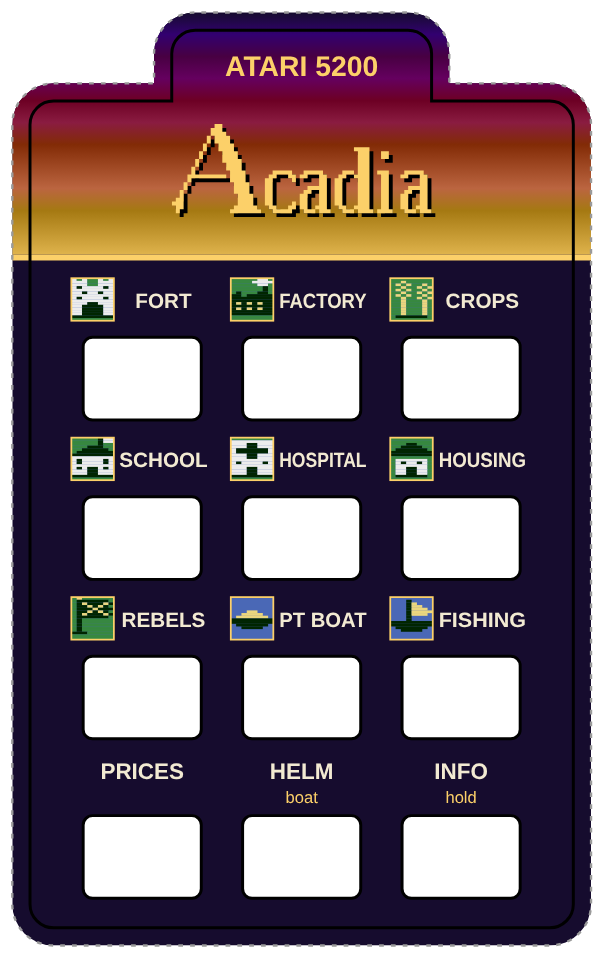
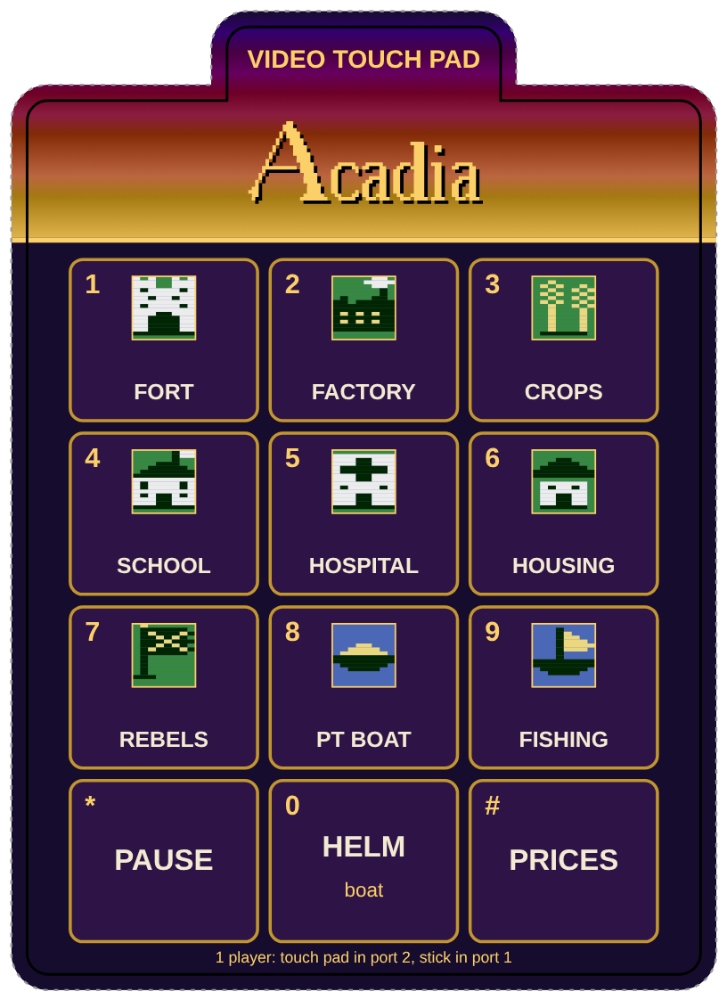

# Keypad overlays

Printable overlays for the two keypads Acadia can use, with the game's
own item icons and logo. Each sheet holds two overlays (one for each
5200 controller; a spare touch pad one) and a 50 mm bar to check the
print scale.

| Controller | Print sheet | Vector (edit) | Image |
|---|---|---|---|
| Atari 5200 controller | [acadia-5200.pdf](acadia-5200.pdf) | [acadia-5200.svg](acadia-5200.svg) | [acadia-5200.png](acadia-5200.png) (300 dpi) |
| Atari CX21 Video Touch Pad (800/XL/XE, port 2) | [acadia-touchpad.pdf](acadia-touchpad.pdf) | [acadia-touchpad.svg](acadia-touchpad.svg) | [acadia-touchpad.png](acadia-touchpad.png) (300 dpi) |

 

## Printing

1. Print the PDF at **100 % / actual size** (no "fit to page") on matte
   card stock, about 200-250 g/m². The sheet is US Letter; everything
   sits inside A4 too.
2. Measure the 50 mm bar. If it isn't 50 mm, the printer scaled the page.
3. Cut along the **solid black** lines. The art runs 1.5 mm past them
   (to the dotted grey line), so a cut a little outside still looks right.
4. 5200: cut out the 12 key windows (white) with a craft knife.
   The touch pad overlay has no windows: the pad is pressed through it.

## Keys

| Key | 5200 | Video Touch Pad |
|---|---|---|
| 1-9 | Buy: fort, factory, crops, school, hospital, housing, rebels, PT boat, fishing boat | same |
| 0 | Take the helm of a boat / anchor it | same |
| `*` | Price list | Pause |
| `#` | Hold for the score pages; press again while holding to step | Price list |

On the 5200 the top side button also takes the helm, the bottom one is
fire, and START / PAUSE are the keys above the keypad.

## Sizes

All sizes are in `DIM_5200` and `DIM_TP` at the top of
[`tools/mkoverlay.py`](../../tools/mkoverlay.py). **They are estimates:**
no published template or measurement was found, so check one against a
real overlay before cutting a batch.

| | 5200 | Touch Pad |
|---|---|---|
| Card (below the tab) | 46 × 70 mm | 64 × 83 mm |
| Pull tab | 22 × 6 mm | 26 × 7 mm |
| Key pitch (centres) | 13.5 × 13.5 mm | 19 × 16.5 mm |
| Key window | 10 × 7 mm | none |

To change them, edit the numbers and rebuild:

```sh
python3 -I tools/mkoverlay.py      # the SVGs
node tools/overlay_render.js       # PDF + PNG (needs Node + Playwright with Chromium)
```
